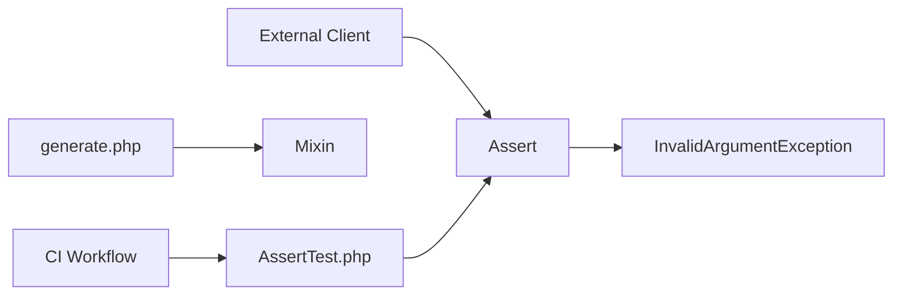

# webmozarts/assert

> Bibliothèque PHP d'assertions pour valider entrées et sorties, avec des messages d'erreur lisibles.

## Le problème
Valider les arguments d'une méthode demande beaucoup de code répétitif, et les messages d'erreur sont souvent inutilisables.

## Ce que ça fait vraiment
La classe `Assert` offre des vérifications de types, de comparaisons, de chaînes, de fichiers, d'objets et de tableaux, qui lèvent une `InvalidArgumentException`. Les préfixes `all*` et `nullOr*` s'appliquent à toutes. Les messages personnalisés suivent un ordre de paramètres cohérent.

## Comment c'est branché


## Essayer
```bash
composer require webmozart/assert
```

## Coût et pièges
Gratuit, installation par Composer. Rien de caché.

## Ce que ce n'est pas
Ce n'est pas un validateur de formulaires ni de schémas : ce sont des garde-fous qui lèvent une exception.

## Alternatives
- beberlei/assert : l'inspiration du projet, mais ordre des marqueurs `%s` irrégulier.

## Pour toi
À ignorer : bibliothèque PHP, hors de ta pile data / IA.

