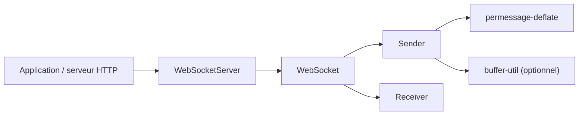

# websockets/ws

> WebSocket client and server for Node.js, tested with the Autobahn suite.

## The problem
Node.js has no WebSocket server in its standard library, and browsers cannot act as servers.

## What it actually does
WebSocket client and server on the Node side only (not in the browser). Supports `permessage-deflate` compression (disabled by default on the server, with a memory cost), authentication at upgrade, several servers on one HTTP server, broadcasting, heartbeats and Node stream mode. Optional native modules: `bufferutil` and `utf-8-validate`.

## How it is wired


## Trying it
```bash
npm install ws
npm install --save-optional bufferutil
```
```js
import { WebSocketServer } from 'ws';
const wss = new WebSocketServer({ port: 8080 });
```

## Cost and gotchas
Free. Compression can cause memory fragmentation under heavy load: test it with your real profile. Proxying goes through a third-party HTTP agent.

## What it is not
It is not a browser client (use the native `WebSocket` object). It provides neither reconnection nor rooms.

## Alternatives
- isomorphic-ws: a wrapper that makes code compatible with both Node and the browser.

## For you
Keep an eye on it: a standard building block if you stream model tokens from a Node service; in Python, other libraries will do.
