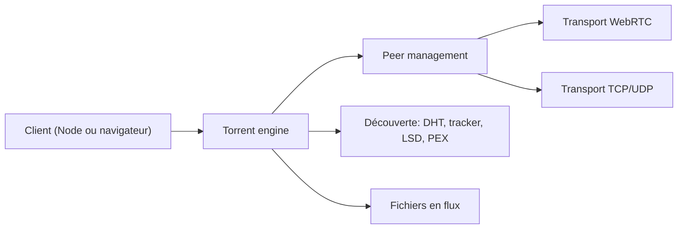

# webtorrent/webtorrent

> BitTorrent client in JavaScript for Node.js and the browser, with streaming playback over WebRTC.

## The problem
Distributing or playing large files peer to peer from a browser requires a BitTorrent client that speaks WebRTC, without a plugin.

## What it actually does
A single npm package works in Node (TCP/UDP) and in the browser (WebRTC channels). It downloads several torrents, exposes files as streams, fetches pieces on demand to allow fast-forwarding, and switches from sequential mode to rarest-first. Peer discovery through DHT, trackers, LSD and ut_pex, magnets via ut_metadata.

## How it is wired


## Trying it
```bash
npm install webtorrent
npm install webtorrent-cli -g
webtorrent --help
webtorrent magnet_uri
```

## Cost and gotchas
Free. A browser peer only talks to WebTorrent/WebRTC clients (Desktop, webtorrent-hybrid, Instant.io, Vuze), not to regular TCP/UDP peers. The README still points to Gitter and freenode.

## What it is not
It is not a universal in-browser client nor a hosting service. No data/AI use is described.

## Alternatives
- webtorrent-hybrid: adds WebRTC to Node to reach browser peers.
- WebTorrent Desktop: client with a graphical interface.

## For you
Ignore: browser peer-to-peer has no described link to data, AI or MLOps; reconsider only to distribute large files without a server.
