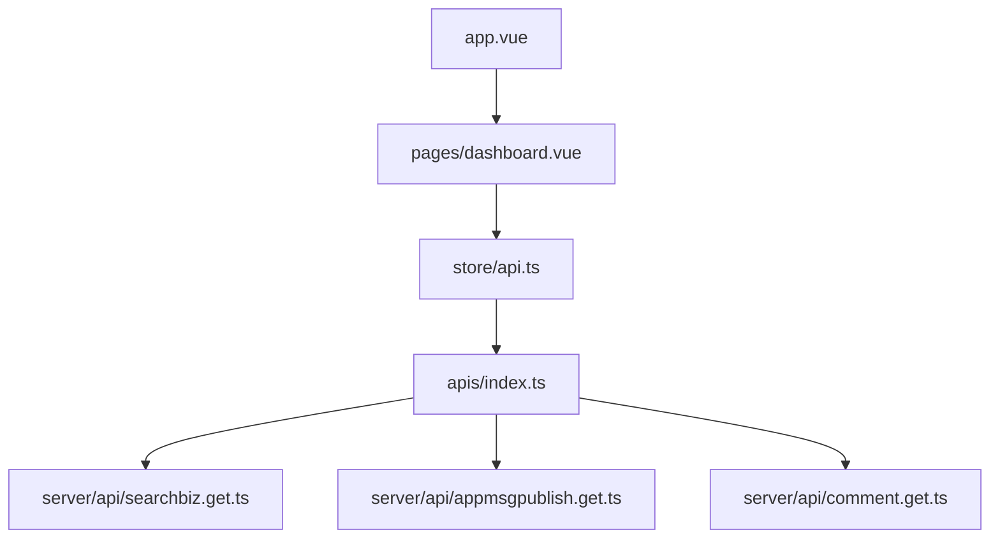

# wechat-article/wechat-article-exporter

> Bulk download tool for WeChat articles, abandoned since July 2026: the upstream interface is closed.

## The problem
Archive all the articles of a WeChat public account with their layout, view counts and comments.

## What it actually does
Nuxt/Vue application with server routes (`server/api`) that search for an account, fetch the article list, the comments and the album, then export to html, json, excel, txt, md or docx. The principle relied on the article search of a public account's back office. The README states that this interface has been closed.

## How it is wired

## Trying it
No command in the README (docs point to a documentation site). The online site has been down since October 2026.

## Cost and gotchas
Free, but the tool depends on a WeChat public account and an upstream interface that no longer exists. The project is read-only, with no new releases.

## What it is not
No longer functional for one-click synchronization. The public API has been withdrawn. The catalog lists it as not archived, but the README announces a move to archive status.

## Alternatives
From the same author, the tool "取阅" (qǔyuè) for receiving articles in real time; no repository named.

## For you
Ignore: discontinued project whose data source has disappeared, so unusable for a pipeline.
