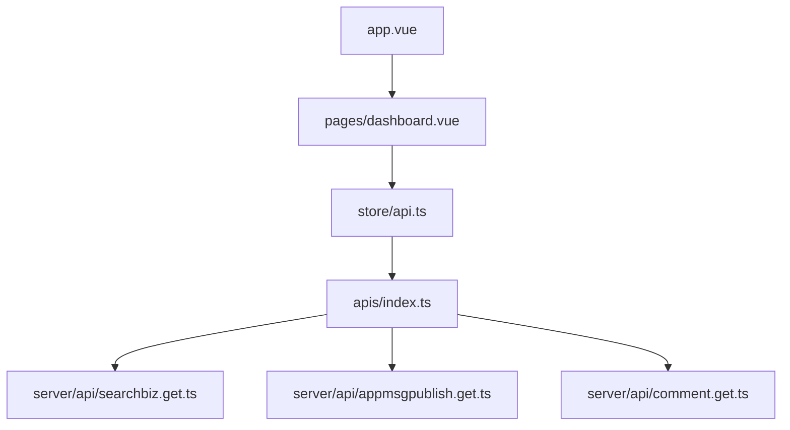

# wechat-article/wechat-article-exporter

> Outil de téléchargement en masse d'articles WeChat, abandonné depuis juillet 2026 : l'interface amont est fermée.

## Le problème
Archiver tous les articles d'un compte public WeChat avec leur mise en page, leurs lectures et leurs commentaires.

## Ce que ça fait vraiment
Application Nuxt/Vue avec des routes serveur (`server/api`) qui cherchent un compte, récupèrent la liste d'articles, les commentaires et l'album, puis exportent en html, json, excel, txt, md ou docx. Le principe s'appuyait sur la recherche d'articles du back-office d'un compte public. Le README annonce que cette interface a été fermée.

## Comment c'est branché

## Essayer
Aucune commande dans le README (docs renvoyées vers un site de documentation). Le site en ligne est hors service depuis octobre 2026.

## Coût et pièges
Gratuit, mais l'outil dépend d'un compte public WeChat et d'une interface amont qui n'existe plus. Le projet est en lecture seule, sans nouvelles versions.

## Ce que ce n'est pas
Plus fonctionnel pour la synchronisation en un clic. L'API publique est retirée. Le catalogue le donne comme non archivé, mais le README annonce un passage en archive.

## Alternatives
Du même auteur, l'outil « 取阅 » (qǔyuè) pour recevoir les articles en temps réel ; aucun dépôt nommé.

## Pour toi
À ignorer : projet arrêté dont la source de données a disparu, donc inutilisable pour un pipeline.

