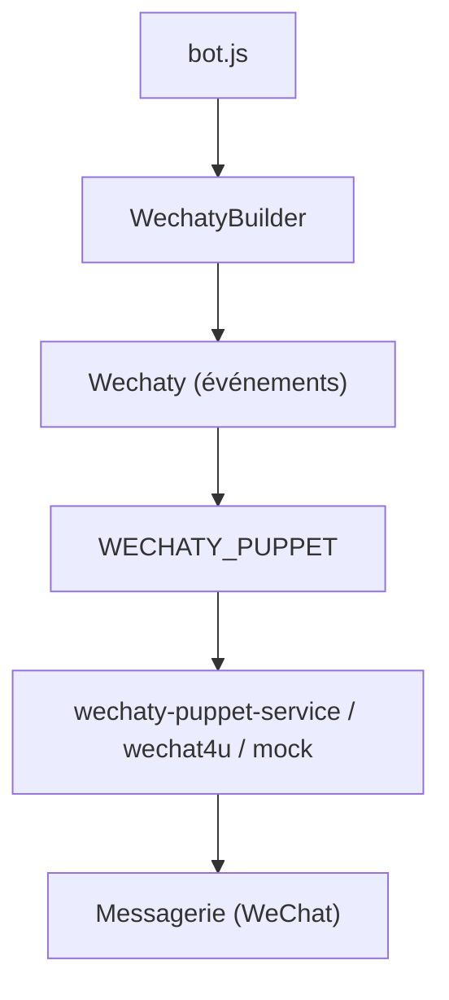

# wechaty/wechaty

> Conversational SDK to write a chatbot once and plug it into WeChat or other messaging apps.

## The problem
Each messaging app has its own API; coding one bot per platform is time-consuming.

## What it actually does
A single API (Wechaty, Contact, Message, Room, Friendship) drives a "puppet" chosen by the `WECHATY_PUPPET` variable. Events cover scan, login, message, room-join. Several puppets are marked obsolete in the README. Also exists in Python, Go, Java and others.

## How it is wired


## Trying it
```bash
npm init
npm install wechaty
node bot.js
docker run -ti --rm --volume="$(pwd)":/bot wechaty/wechaty bot.js
```

## Cost and gotchas
Node 16+. Some puppets go through a third-party service; the README mentions a free token but does not detail paid plans. A VPS outside China is recommended.

## What it is not
Not a conversational AI framework: it handles message transport. The README keeps an old history section (2021).

## Alternatives
Python Wechaty, Go Wechaty, Java Wechaty: same APIs in other languages.

## For you
Ignore: oriented toward WeChat and bot automation, unrelated to data / AI / MLOps work.
