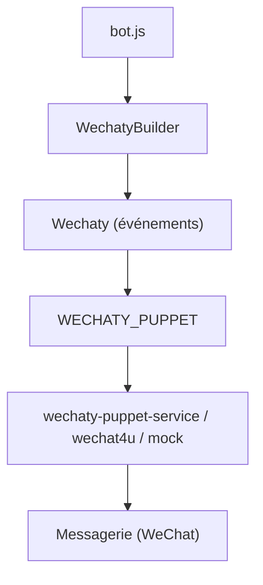

# wechaty/wechaty

> SDK conversationnel pour écrire un chatbot une fois et le brancher sur WeChat ou d'autres messageries.

## Le problème
Chaque messagerie a son API ; coder un bot par plateforme est long.

## Ce que ça fait vraiment
Une API unique (Wechaty, Contact, Message, Room, Friendship) pilote un « puppet » choisi par la variable `WECHATY_PUPPET`. Les événements couvrent scan, login, message, room-join. Plusieurs puppets sont marqués obsolètes dans le README. Existe aussi en Python, Go, Java et autres.

## Comment c'est branché


## Essayer
```bash
npm init
npm install wechaty
node bot.js
docker run -ti --rm --volume="$(pwd)":/bot wechaty/wechaty bot.js
```

## Coût et pièges
Node 16+. Certains puppets passent par un service tiers ; le README parle d'un jeton gratuit mais ne détaille pas les offres payantes. VPS hors de Chine conseillé.

## Ce que ce n'est pas
Pas un framework d'IA conversationnelle : il gère le transport des messages. Le README garde une section d'historique ancienne (2021).

## Alternatives
Python Wechaty, Go Wechaty, Java Wechaty : mêmes API dans d'autres langages.

## Pour toi
À ignorer : orienté WeChat et automatisation de bots, sans lien avec un travail data / IA / MLOps.

