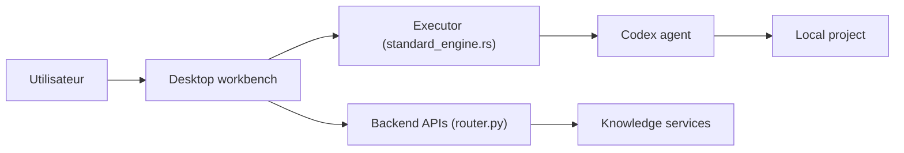

# wecode-ai/Wegent

> Open source AI workstation, desktop and web, for local, remote and team coding agents.

## The problem
Coding tasks handed to agents stay stuck on one machine; teams and devices share neither projects nor history.

## What it actually does
Wegent Desktop (Electron) organizes projects, tasks, files, tests and diffs, and drives Codex through an Executor. A Backend shares project workspaces, models and execution devices; Wegent Web offers agents, knowledge and administration. Self-hosting via Docker. Components: Python and Rust backend, chat_shell, knowledge services.

## How it is wired


## Trying it
```bash
curl -fsSL https://raw.githubusercontent.com/wecode-ai/Wegent/main/install.sh | bash -s -- --standalone
pnpm install
pnpm --filter wework dev
```

## Cost and gotchas
Models to configure at your own expense; heavy multi-service stack. The README does not detail costs. Remote execution: plan for device isolation.

## What it is not
Not a new model: it orchestrates Codex. The workstation relies on that engine, and therefore on its limits.

## Alternatives
No alternative named in the README.

## For you
Worth watching: ambitious for team work with coding agents, but broad and young; evaluate on a pilot project.
