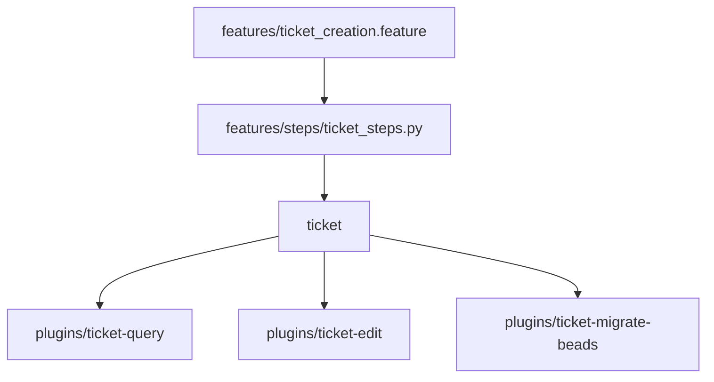

# wedow/ticket

> Ticket manager as a bash script over markdown files in git, designed for AI agents.

## The problem
Task trackers for agents (like beads) impose a SQLite database to synchronize and a daemon that can damage changes.

## What it actually does
`tk` creates markdown tickets with a YAML header in `.tickets/`, and manages statuses, dependencies, links, notes and `ready` / `blocked` lists. Plugins extend the commands; `migrate-beads` imports from beads. A simple bash script with coreutils; `jq` for the `query` command.

## How it is wired
Diagram based on the code diagram.


## Trying it
```bash
brew tap wedow/tools
brew install ticket
tk help
tk migrate-beads
```

## Cost and gotchas
Free. The tests require Python (behave, uv). For the agent, you must add a line to `CLAUDE.md`; models other than Claude Opus may need more instructions.

## What it is not
Not a collaborative project management tool with an interface: everything is on the command line and in git.

## Alternatives
- beads: the tool `tk` replaces, with SQLite and a daemon.

## For you
Worth watching: useful if you orchestrate coding agents and want lightweight task tracking versioned with the repository.
