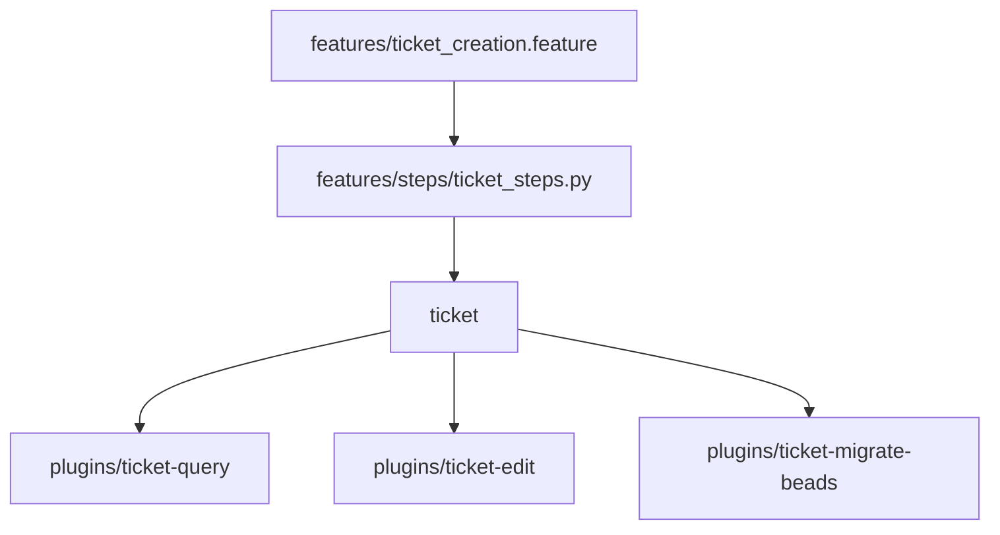

# wedow/ticket

> Gestionnaire de tickets en script bash sur fichiers markdown dans git, pensé pour les agents IA.

## Le problème
Les suivis de tâches pour agents (comme beads) imposent une base SQLite à synchroniser et un démon qui peut abîmer les changements.

## Ce que ça fait vraiment
`tk` crée des tickets markdown avec en-tête YAML dans `.tickets/`, gère statuts, dépendances, liens, notes et listes `ready` / `blocked`. Des plugins étendent les commandes ; `migrate-beads` importe depuis beads. Un simple script bash avec coreutils ; `jq` pour la commande `query`.

## Comment c'est branché
Schéma d'après le diagramme du code.


## Essayer
```bash
brew tap wedow/tools
brew install ticket
tk help
tk migrate-beads
```

## Coût et pièges
Gratuit. Les tests demandent Python (behave, uv). Pour l'agent, il faut ajouter une ligne à `CLAUDE.md` ; d'autres modèles que Claude Opus peuvent exiger plus de consignes.

## Ce que ce n'est pas
Pas un outil de gestion de projet collaboratif avec interface : tout est en ligne de commande et dans git.

## Alternatives
- beads : l'outil que `tk` remplace, avec SQLite et démon.

## Pour toi
À surveiller : utile si tu orchestres des agents de code et veux un suivi de tâches léger versionné avec le dépôt.

