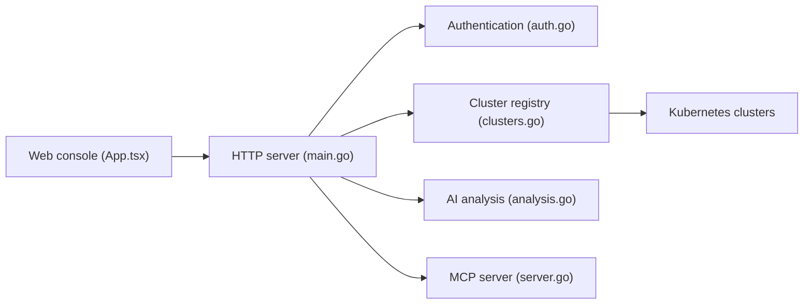

# weibaohui/k8m

> Lightweight Kubernetes console in a single executable, with AI assistance and a built-in MCP server.

## The problem
Managing several clusters means juggling kubectl, dashboards and diagnostic tools, with no help interpreting logs and events.

## What it actually does
Web console (AMIS) and Go backend in one binary: resources, YAML, files and shell in pods, Helm, CRDs, scheduled inspections (Lua scripts), event forwarding to webhooks. AI features: explanation, reading of describe output and logs. MCP server with 49 cluster tools, executed with the calling user's permissions. Multi-cluster, permissions per user and group.

## How it is wired


## Trying it
```bash
./k8m
# puis http://127.0.0.1:3618 (utilisateur k8m, mot de passe k8m)
```

## Cost and gotchas
Default credentials k8m/k8m and a default JWT secret: change them. The built-in AI goes through a model or your own (Ollama possible). README mostly in Chinese.

## What it is not
Not an MLOps tool: it is a general-purpose Kubernetes console. The built-in model's performance is not quantified in the README.

## Alternatives
No alternative named in the README (k8sgpt is built in).

## For you
Worth watching: handy for exploring clusters with AI help, but change the default passwords and check the MCP permissions before exposing it.
