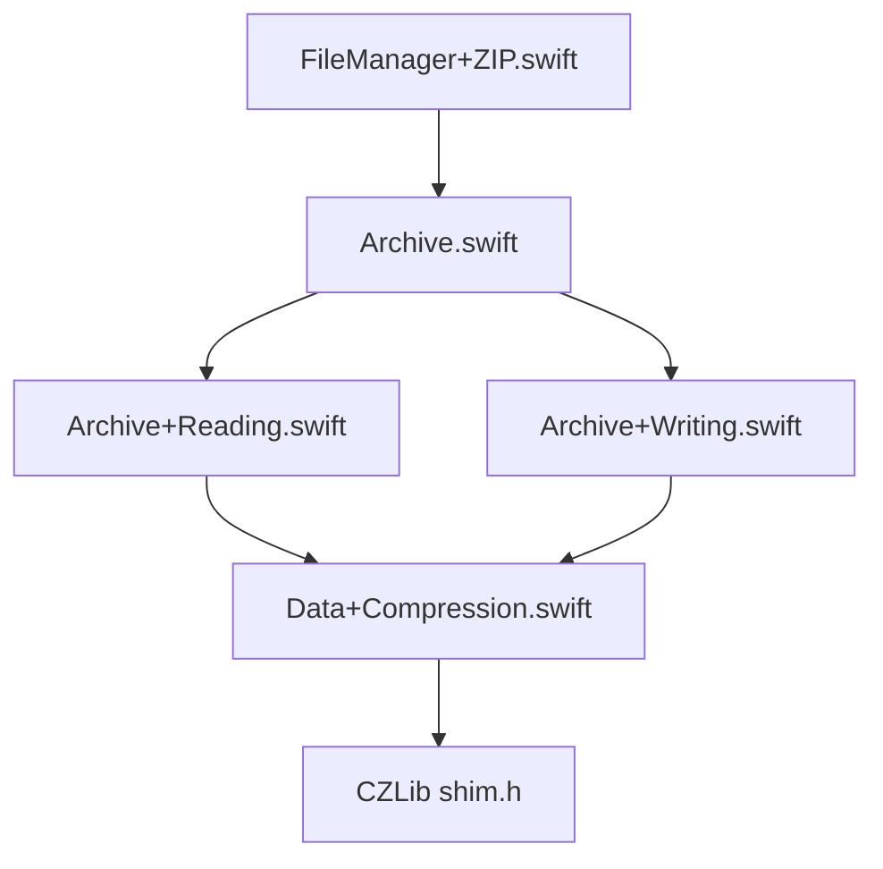

# weichsel/ZIPFoundation

> Swift library to create, read and modify ZIP archives on Apple platforms and Linux.

## The problem
Handling ZIP files in Swift without a third-party dependency or shelling out to the command line.

## What it actually does
`FileManager` extensions (`zipItem`, `unzipItem`) and an `Archive` class to access individual entries, add or remove them. In-memory archives, closure-based reading, progress tracking and cancellation, ZIP64. Compression through libcompression on Apple, zlib on Linux.

## How it is wired
Diagram based on the code diagram.



## Trying it
```bash
swift package resolve
carthage update --no-build
pod install
```

## Cost and gotchas
Free. Swift and Xcode required (outside the prerequisites list); on Linux, the zlib development package. By default, `zipItem` creates an archive with no compression: you must specify `.deflate`.

## What it is not
Not a command-line tool nor a multi-language library.

## Alternatives
No alternative named in the README.

## For you
Ignore: only useful if you write Swift applications.
