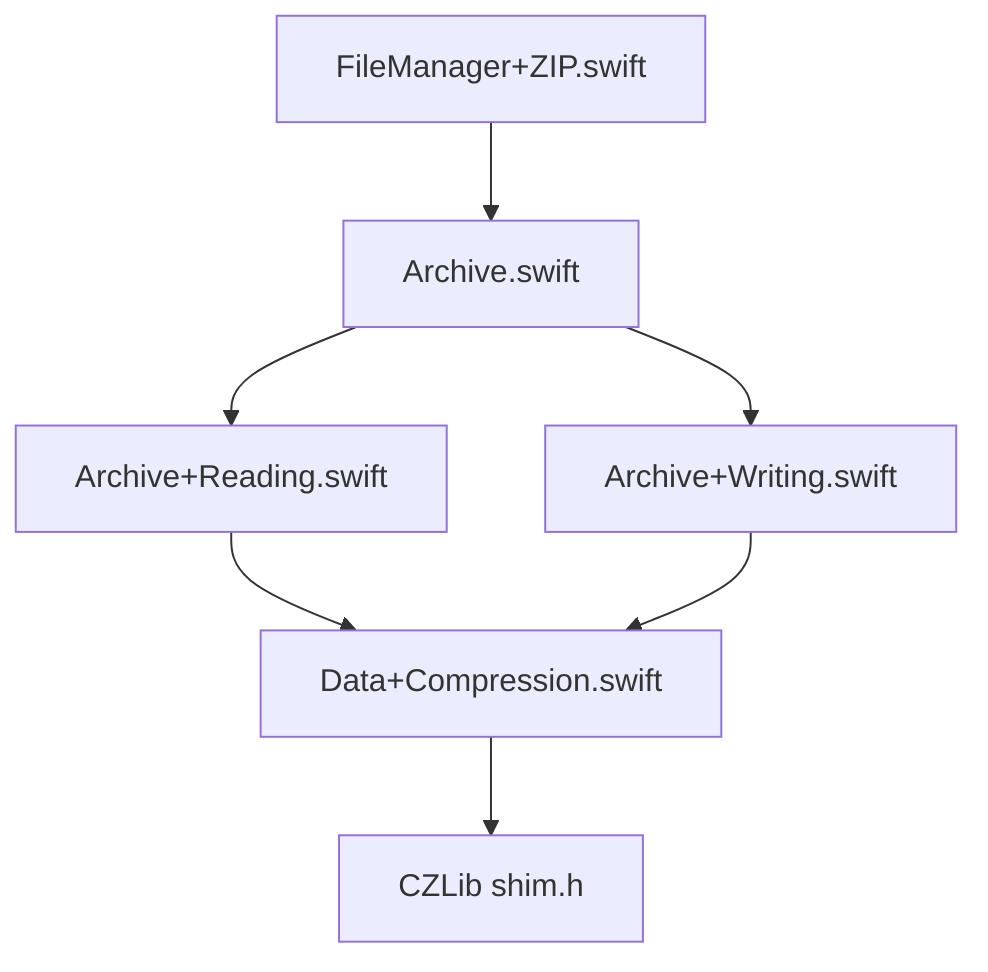

# weichsel/ZIPFoundation

> Bibliothèque Swift pour créer, lire et modifier des archives ZIP sur les plateformes Apple et Linux.

## Le problème
Manipuler des ZIP en Swift sans dépendance tierce ni passer par la ligne de commande.

## Ce que ça fait vraiment
Extensions de `FileManager` (`zipItem`, `unzipItem`) et classe `Archive` pour accéder à des entrées individuelles, les ajouter ou les retirer. Archives en mémoire, lecture par fermetures, suivi de progression et annulation, ZIP64. Compression via libcompression sur Apple, zlib sur Linux.

## Comment c'est branché
Schéma d'après le diagramme du code.



## Essayer
```bash
swift package resolve
carthage update --no-build
pod install
```

## Coût et pièges
Gratuit. Swift et Xcode requis (hors liste des prérequis) ; sous Linux, le paquet de développement zlib. Par défaut, `zipItem` crée une archive sans compression : il faut préciser `.deflate`.

## Ce que ce n'est pas
Pas un outil en ligne de commande ni une bibliothèque multi-langage.

## Alternatives
Aucune alternative nommée dans le README.

## Pour toi
À ignorer : utile seulement si tu écris des applications Swift.

