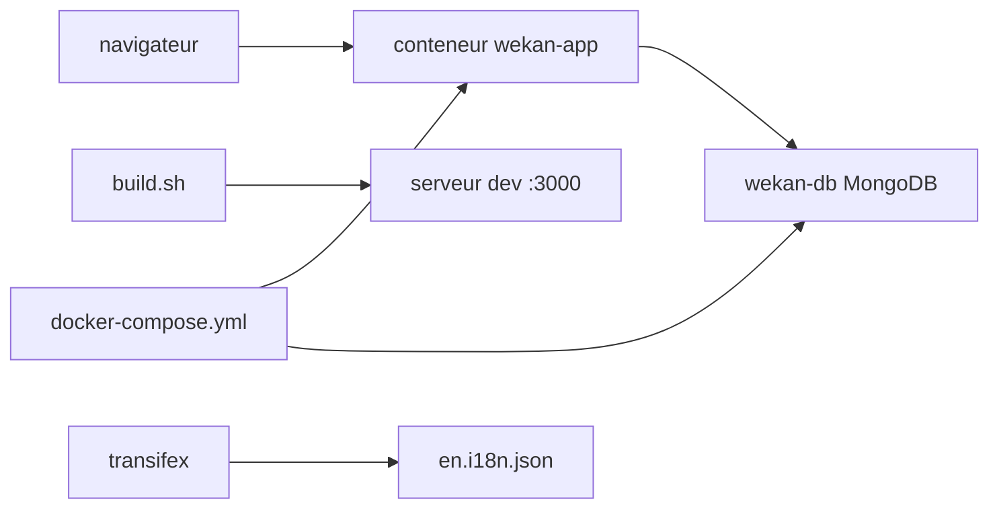

# wekan/wekan

> Self-hosted collaborative kanban board, MIT-licensed, for teams or personal use.

## The problem
SaaS kanban boards force you to entrust your data and projects to a third party.
Switching tools or starting over from your own data then becomes a negotiation, not a file copy.

## What it actually does
Real-time kanban boards, translated into 234 languages, installable on your machine or your server.
Images published on GitHub Container Registry, Docker Hub and Quay.io, with a `docker-compose.yml` in the repo.
Development happens on Meteor 3.5 / Node.js 24.x through a menu-driven `build.sh` script.
Translations go exclusively through Transifex; only English strings arrive in PRs.

## How it is wired


## Trying it
```bash
git clone git@github.com:YOUR_USERNAME/wekan.git
cd wekan
chmod +x build.sh
./build.sh
```
Or as a container, with the `ghcr.io/wekan/wekan:latest` image and the repo's `docker-compose.yml`.

## Cost and gotchas
1 GB of free RAM minimum, 4 GB recommended in production, and disk space to keep an eye on:
MongoDB gets corrupted if the disk fills up. Only the latest version is supported.

## What it is not
Not a forgiving tool: there is no undo, deleting a list or a card is permanent.
Not a service you can leave running for a year without touching it — updates are security fixes.
Nor a complete standard: 8 of the 16 criteria of the Standard for Public Code were met in 2023-11.

## Alternatives
None named in the README.

## For you
Useful if you want a kanban at home; otherwise it is extra MongoDB operations, unrelated to your job.
