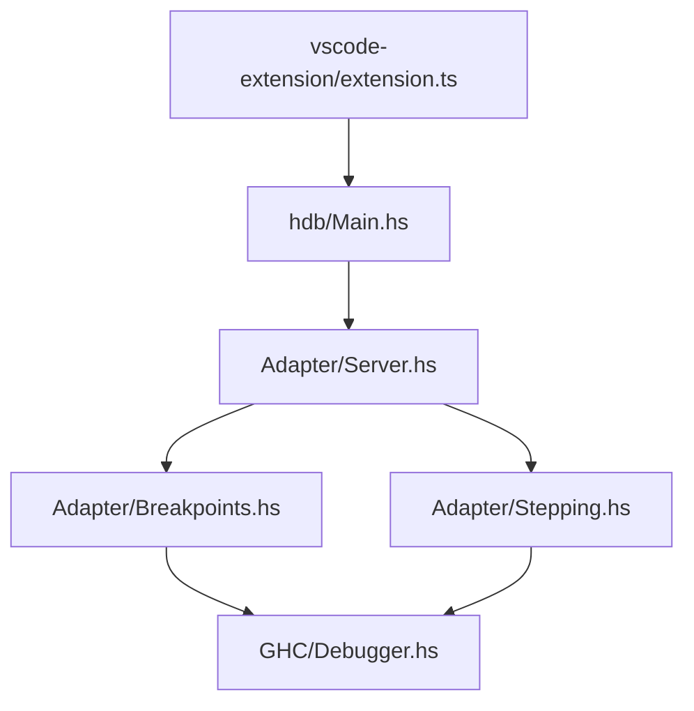

# well-typed/haskell-debugger

> Step-by-step Haskell debugger for VSCode and other editors, via the DAP protocol.

## The problem
Debugging Haskell with ghci is impractical: no comfortable breakpoints in the editor.

## What it actually does
`hdb` is a DAP server built directly on the GHC API. It handles breakpoints (module, function, exception, conditional) and stepping. Types can be displayed via `DebugView`. It requires GHC 9.14; stepping backwards is not implemented.

## How it is wired
Diagram based on the code diagram.



## Trying it
```bash
cabal build -w /path/to/ghc-9.14 exe:hdb
hdb server --port 12345
cabal run haskell-debugger-test
```

## Cost and gotchas
Free. The GHC 9.14 that compiled `hdb` must be in the PATH; building from source requires Cabal (and Nix for the extension). The binary can be fetched from the GitHub Releases.

## What it is not
Not a debugger for GHC versions earlier than 9.14 (see `haskell-debugger-adapter`). No reverse debugging or data breakpoints.

## Alternatives
- `haskell-debug-adapter`: works with GHC 9.12 and earlier.

## For you
Ignore: useful only if you write Haskell, nothing for a data / AI / MLOps profile.
