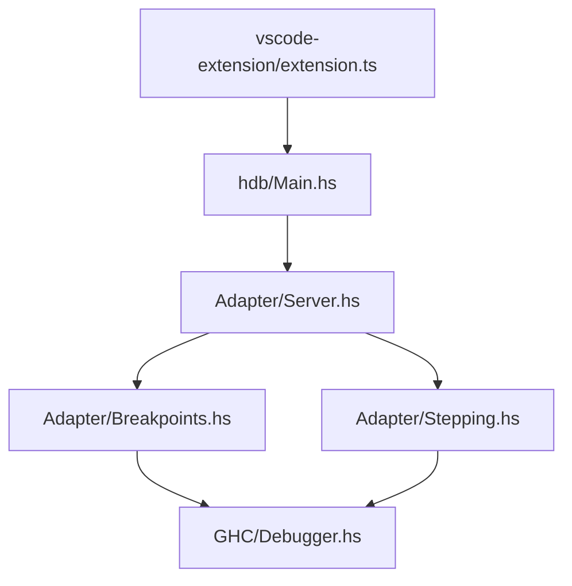

# well-typed/haskell-debugger

> Débogueur Haskell à pas à pas pour VSCode et autres éditeurs, via le protocole DAP.

## Le problème
Déboguer du Haskell avec ghci est peu pratique : pas de points d'arrêt confortables dans l'éditeur.

## Ce que ça fait vraiment
`hdb` est un serveur DAP construit directement sur l'API GHC. Il gère points d'arrêt (module, fonction, exception, conditionnels) et pas à pas. Les types peuvent être affichés via `DebugView`. Il exige GHC 9.14 ; les pas en arrière ne sont pas faits.

## Comment c'est branché
Schéma d'après le diagramme du code.



## Essayer
```bash
cabal build -w /path/to/ghc-9.14 exe:hdb
hdb server --port 12345
cabal run haskell-debugger-test
```

## Coût et pièges
Gratuit. Il faut le GHC 9.14 qui a compilé `hdb` dans le PATH ; compiler depuis les sources demande Cabal (et Nix pour l'extension). Le binaire se récupère dans les Releases GitHub.

## Ce que ce n'est pas
Pas un débogueur pour les GHC antérieurs à 9.14 (voir `haskell-debugger-adapter`). Pas de débogage inverse ni de points d'arrêt de données.

## Alternatives
- `haskell-debug-adapter` : fonctionne avec GHC 9.12 et antérieurs.

## Pour toi
Ignorer : utile seulement si tu écris du Haskell, rien pour un profil data / IA / MLOps.

