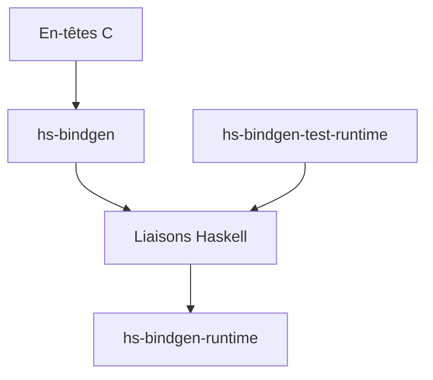

# well-typed/hs-bindgen

> Automatic generator of Haskell FFI bindings from C headers, for Haskell developers.

## The problem
Writing Haskell FFI bindings to a C library by hand is slow and error-prone.

## What it actually does
Reads C headers and generates the Haskell bindings. Three packages: `hs-bindgen`, `hs-bindgen-runtime` and `hs-bindgen-test-runtime`. Tested examples cover Botan, libpcap, LibYAML, MiniSat, QR-Code-generator, RogueUtil, rpm and CEF. Available on Hackage.

## How it is wired
Simplified diagram based on the sheet, no diagram provided.



## Trying it
```bash
# aucune commande dans le README : voir le manuel hs-bindgen et le tutoriel Nix
```

## Cost and gotchas
Free. More than 280 open issues. The examples are used for testing; they are not exhaustive.

## What it is not
Not a tool for C++ in general: Botan, a C++ library, goes through its C interface.

## Alternatives
No alternative named in the README.

## For you
Ignore: only useful to Haskell developers who call C, outside your data / AI toolchain.
