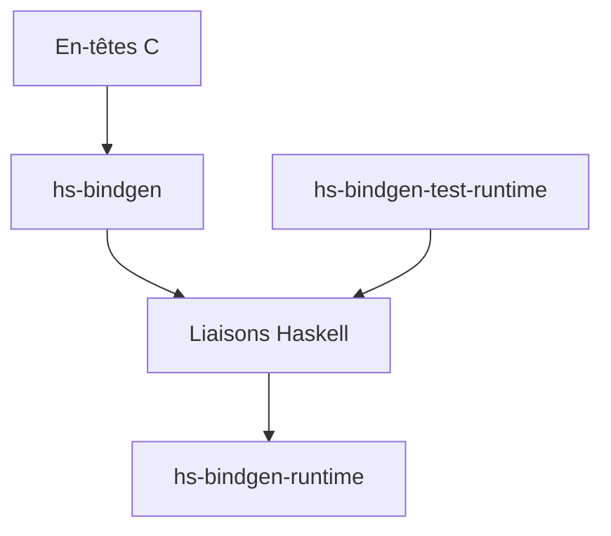

# well-typed/hs-bindgen

> Générateur automatique de liaisons FFI Haskell à partir d'en-têtes C, pour développeurs Haskell.

## Le problème
Écrire à la main des liaisons FFI Haskell vers une bibliothèque C est long et source d'erreurs.

## Ce que ça fait vraiment
Lit des en-têtes C et génère les liaisons Haskell. Trois paquets : `hs-bindgen`, `hs-bindgen-runtime` et `hs-bindgen-test-runtime`. Des exemples testés couvrent Botan, libpcap, LibYAML, MiniSat, QR-Code-generator, RogueUtil, rpm et CEF. Disponible sur Hackage.

## Comment c'est branché
Schéma simplifié d'après la fiche, sans diagramme fourni.



## Essayer
```bash
# aucune commande dans le README : voir le manuel hs-bindgen et le tutoriel Nix
```

## Coût et pièges
Gratuit. Plus de 280 issues ouvertes. Les exemples servent aux tests, ils ne sont pas complets.

## Ce que ce n'est pas
Pas un outil pour C++ en général : Botan, bibliothèque C++, passe par son interface C.

## Alternatives
Aucune alternative nommée dans le README.

## Pour toi
Ignorer : utile aux seuls Haskellers qui appellent du C, hors de ta chaîne data / IA.

