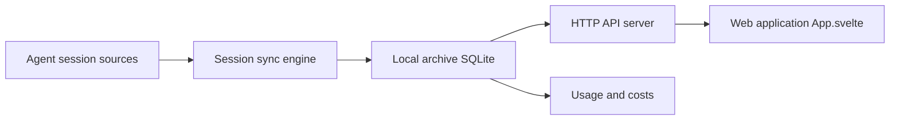

# wesm/agentsview

> Local archive and dashboard of coding-agent sessions, with search and token cost tracking.

## The problem
Sessions from Claude Code, Codex or Copilot are scattered, hard to find, and their cost is opaque.

## What it actually does
Discovers sessions from supported agents, syncs them into a local SQLite database and serves a web interface (FTS5, optional semantic search, heatmaps). `agentsview usage daily` computes costs per model using LiteLLM/OpenRouter pricing. Can push to PostgreSQL, ClickHouse or DuckDB.

## How it is wired


## Trying it
```bash
curl -fsSL https://agentsview.io/install.sh | bash
agentsview serve
agentsview usage daily
```

## Cost and gotchas
Free; it serves on 127.0.0.1:8080 by default. Behind a tunnel or proxy, use `--public-url`; beyond loopback, enable `--require-auth`.

## What it is not
Not a cloud service: data stays local. An anonymous `daily_active` ping to PostHog exists, which can be disabled with `AGENTSVIEW_TELEMETRY_ENABLED=0`.

## Alternatives
No alternative named in the README.

## For you
Adopt if you use several coding agents: the cost and session observability is directly usable, and the data stays with you.
