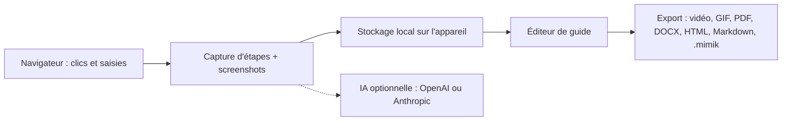

# westpoint-io/mimik

> Browser extension that turns a click path into an illustrated guide, with no account and no cloud.

## The problem
Manually documenting a path through a web tool (screenshots, annotations, text) takes longer than the task itself, and the result quickly goes stale.

## What it actually does
You start recording and do your task: every click, input, shortcut or navigation becomes a step with a screenshot and a highlighted, zoomed element. An editor lets you crop, annotate and reorder. The guide exports to video, GIF, PDF, DOCX, HTML or Markdown, or replays live (Guide Me). Everything stays in the browser; AI descriptions and voice are optional, with your own key.

## How it is wired
Simplified diagram based on the sheet, no diagram provided.



## Trying it
```bash
# Aucune commande documentée : installation par les magasins d'extensions
# Chrome Web Store, Firefox Add-ons ou Microsoft Edge Add-ons
```

## Cost and gotchas
Free. The AI, voice and voice-over options require your key (OpenAI, Anthropic, Groq or ElevenLabs) and are billed by them. Site icons go through Google's favicon service.

## What it is not
The smart blur is not a GDPR guarantee: it ignores iframes, Shadow DOM, text in images, CSS pseudo-elements and any text that appeared after "Done". Screenshots already taken are not blurred after the fact. Only the .mimik format can be re-imported.

## Alternatives
No alternative cited in the README.

## For you
Worth watching: useful to document an MLOps runbook or train a colleague on an internal tool, but with no direct link to data or AI, and the blur does not exempt you from reviewing the screenshots.
