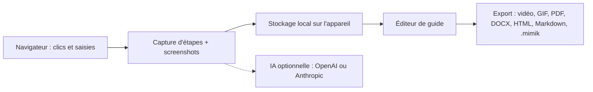

# westpoint-io/mimik

> Extension de navigateur qui transforme un parcours de clics en guide illustré, sans compte ni cloud.

## Le problème
Documenter à la main un parcours dans un outil web (captures, annotations, texte) prend plus de temps que la tâche elle-même, et le résultat vieillit vite.

## Ce que ça fait vraiment
Tu lances l'enregistrement, tu fais ta tâche : chaque clic, saisie, raccourci ou navigation devient une étape avec capture, élément surligné et zoomé. Un éditeur permet de recadrer, annoter, réordonner. Le guide s'exporte en vidéo, GIF, PDF, DOCX, HTML ou Markdown, ou se rejoue en direct (Guide Me). Tout reste dans le navigateur ; les descriptions IA et la voix sont optionnelles, avec ta propre clé.

## Comment c'est branché
Schéma simplifié d'après la fiche, sans diagramme fourni.



## Essayer
```bash
# Aucune commande documentée : installation par les magasins d'extensions
# Chrome Web Store, Firefox Add-ons ou Microsoft Edge Add-ons
```

## Coût et pièges
Gratuit. Les options IA, voix et voix off demandent ta clé (OpenAI, Anthropic, Groq ou ElevenLabs) et sont facturées chez eux. Les icônes de sites passent par le service favicon de Google.

## Ce que ce n'est pas
Le flou intelligent n'est pas une garantie RGPD : il ignore les iframes, le Shadow DOM, le texte dans les images, les pseudo-éléments CSS et tout texte apparu après « Done ». Les captures déjà prises ne sont pas floutées après coup. Seul le format .mimik se réimporte.

## Alternatives
Aucune alternative citée dans le README.

## Pour toi
À surveiller : utile pour documenter un runbook MLOps ou former un collègue à un outil interne, mais sans lien direct avec la donnée ou l'IA, et le flou ne dispense pas de relire les captures.

