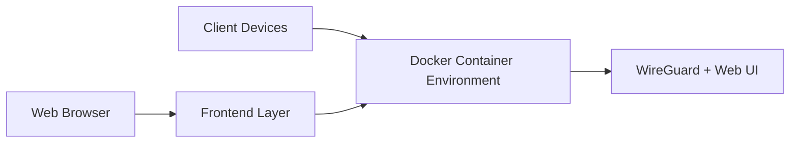

# wg-easy/wg-easy

> All-in-one web interface to install and manage a WireGuard server on a Linux host.

## The problem
Configuring WireGuard by hand, creating clients and distributing their files is tedious and error-prone.

## What it actually does
A Docker container that bundles WireGuard and a web interface: create, edit, enable or delete clients, show their QR code, download the configuration, see connected clients and Tx/Rx charts. Options mentioned: one-time links, client expiration, Prometheus metrics, IPv6, 2FA, per-client filtering (iptables), OIDC (Google, GitHub, Authelia, Authentik).

## How it is wired


## Trying it
```bash
curl -sSL https://get.docker.com | sh
pnpm dev
```
(deployment is done through Docker Compose: the README points to the detailed documentation)

## Cost and gotchas
Free. It needs Docker and root access on a Linux host; the README recommends a reverse proxy to expose the interface on the Internet. A migration is required from the old version. AGPL-3.0.

## What it is not
It is not a managed VPN or a cloud service. The diagram provided by the code is very sketchy: the internal structure is not documented here.

## Alternatives
- No alternative named in the README.

## For you
Keep an eye on it: handy for reaching a GPU server or a homelab over VPN, but only to be exposed with a reverse proxy and 2FA.
