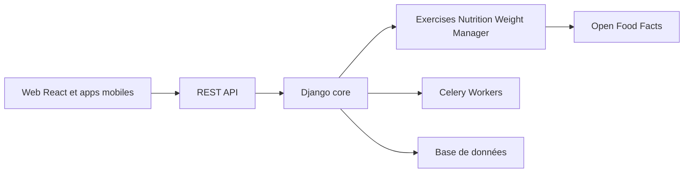

# wger-project/wger

> Free, self-hostable workout and nutrition manager, with mobile apps.

## The problem
Track workout programs, weight, measurements and calories without handing your data to a closed service.

## What it actually does
Django application: routines with automatic progression, weight and measurement tracking, food diary backed by Open Food Facts, progress gallery, exercise wiki, basic gym management, REST API. Asynchronous tasks via Celery, React front end, production Docker images.

## How it is wired


## Trying it
```bash
docker compose up -d
```

## Cost and gotchas
Free; self-hosting through Docker Compose (detailed documentation is online). AGPL-3.0 license: modifications served over a network must be published.

## What it is not
Not a medical health tool: it is a personal tracking journal.

## Alternatives
No alternative named in the README.

## For you
Ignore: a self-hosted fitness application, outside the data/AI/MLOps scope, unless you want an example of a complete Django project.
