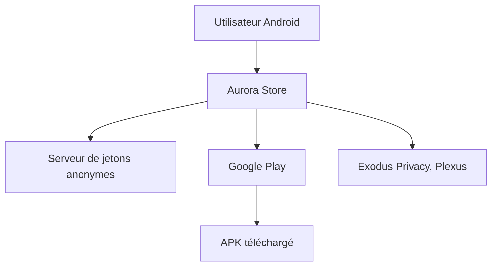

# whyorean/AuroraStore

> Free Android client to browse and download applications from the Google Play Store.

## The problem
Accessing the Google Play catalog without Google services or the official store, with more privacy.

## What it actually does
Connects to Google Play (personal or anonymous account) and downloads APKs. Adds device and region spoofing, Exodus Privacy tracker information, microG compatibility via Plexus, an update blacklist, a download manager, and older versions. Reverse-engineered API.

## How it is wired
Simplified diagram based on the sheet, no diagram provided.

## Trying it
No command: download from the official site, GitLab, IzzyOnDroid or F-Droid.

## Cost and gotchas
Free. No paid apps, and no Play Asset Delivery. The anonymous token server is unreliable; the reverse-engineered API may break. Broad permissions (installation, storage).

## What it is not
Not an app store of its own: it distributes nothing itself. No approval from Google.

## Alternatives
No alternative cited in the README.

## For you
Ignore: consumer mobile client, unrelated to a data, AI or MLOps profile.
