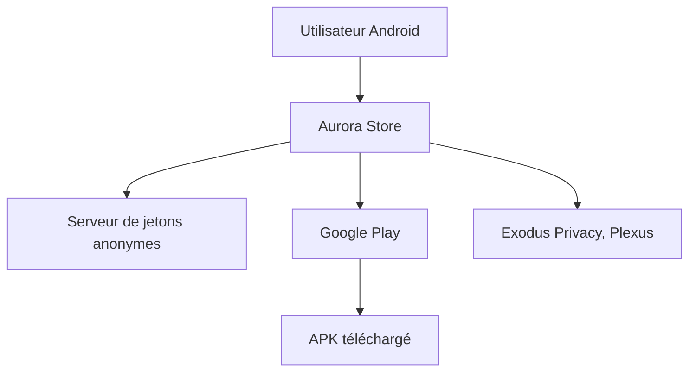

# whyorean/AuroraStore

> Client Android libre pour parcourir et télécharger les applications du Google Play Store.

## Le problème
Accéder au catalogue Google Play sans les services Google ni la boutique officielle, avec plus de confidentialité.

## Ce que ça fait vraiment
Se connecte à Google Play (compte personnel ou anonyme) et télécharge les APK. Ajoute usurpation d'appareil et de région, infos de traqueurs Exodus Privacy, compatibilité microG via Plexus, liste noire de mises à jour, gestionnaire de téléchargement, versions anciennes. API rétro-conçue.

## Comment c'est branché
Schéma simplifié d'après la fiche, sans diagramme fourni.

## Essayer
Aucune commande : télécharger depuis le site officiel, GitLab, IzzyOnDroid ou F-Droid.

## Coût et pièges
Gratuit. Pas d'apps payantes, ni de Play Asset Delivery. Le serveur de jetons anonymes est peu fiable ; l'API rétro-conçue peut casser. Permissions étendues (installation, stockage).

## Ce que ce n'est pas
Pas un magasin d'applications propre : il ne distribue rien lui-même. Aucune approbation de Google.

## Alternatives
Aucune alternative citée dans le README.

## Pour toi
Ignorer : client mobile grand public, sans lien avec un profil data, IA ou MLOps.

