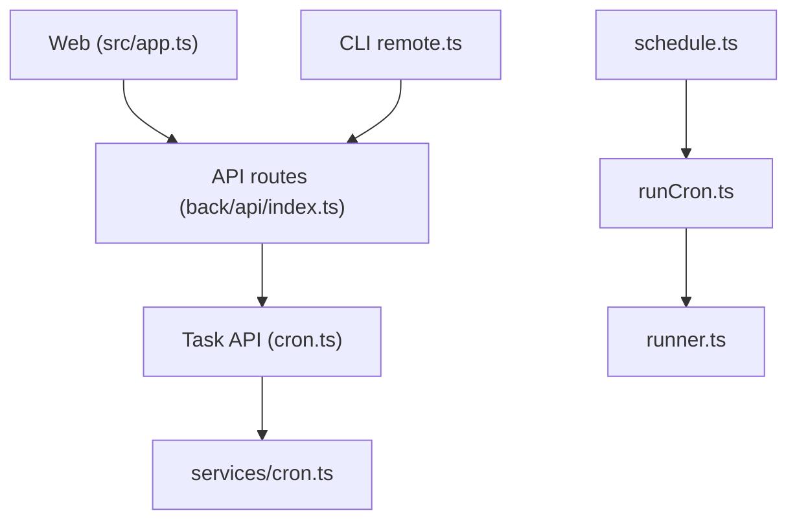

# whyour/qinglong

> Web panel for scheduling tasks in Python, JavaScript, Shell and TypeScript.

## The problem
Scheduled scripts scattered across crontabs are hard to follow: no centralized logs, scattered environment variables, no interface.

## What it actually does
A web panel lets you manage scripts, environment variables, configuration, tasks (scheduling down to the second) and subscriptions. It displays logs, sends system notifications, works in dark mode and on mobile. The scheduler launches a cron runner that executes the script. A remote `ql` CLI and an AI agent skill drive a remote panel.

## How it is wired


## Trying it
```bash
docker pull whyour/qinglong:latest
docker run -d -v /path/to/ql/data:/ql/data -p 5700:5700 --user qinglong --name qinglong whyour/qinglong:debian
npm i @whyour/qinglong
npm install -g @whyour/qinglong-cli
```

## Cost and gotchas
Free. Docker recommended; the alpine image requires root for crond, otherwise use the debian image. The npm version requires you to install node, python3, pip3 and pnpm yourself. The CLI requires Node 22.12 or later.

## What it is not
It is not a DAG-style pipeline orchestrator: it is a cron with an interface. The documentation (deployment, API, commands) is an external link, not reproduced in the README. The npm `ql` may overwrite the `ql` built into the panel.

## Alternatives
- crontab-ui: web interface for crontab, cited in the README's links.

## For you
Worth watching: handy for scheduling small collection or maintenance scripts, but there is a single maintainer and the interface is mostly Chinese; for serious data pipelines, a real orchestrator remains preferable.
