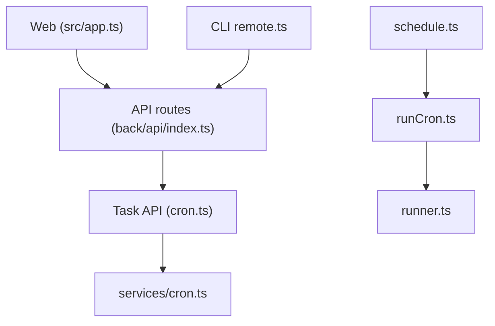

# whyour/qinglong

> Panneau web de planification de tâches planifiées en Python, JavaScript, Shell et TypeScript.

## Le problème
Des scripts planifiés éparpillés dans des crontabs sont difficiles à suivre : pas de logs centralisés, variables d'environnement dispersées, pas d'interface.

## Ce que ça fait vraiment
Un panneau web permet de gérer scripts, variables d'environnement, configuration, tâches (planification à la seconde) et abonnements. Il affiche les logs, envoie des notifications système, fonctionne en mode sombre et sur mobile. Le planificateur lance un exécuteur de cron qui exécute le script. Une CLI distante `ql` et un skill pour agent IA pilotent un panneau distant.

## Comment c'est branché


## Essayer
```bash
docker pull whyour/qinglong:latest
docker run -d -v /path/to/ql/data:/ql/data -p 5700:5700 --user qinglong --name qinglong whyour/qinglong:debian
npm i @whyour/qinglong
npm install -g @whyour/qinglong-cli
```

## Coût et pièges
Gratuit. Docker conseillé ; l'image alpine exige root pour crond, sinon utiliser l'image debian. La version npm demande d'installer soi-même node, python3, pip3 et pnpm. La CLI demande Node 22.12 ou plus.

## Ce que ce n'est pas
Ce n'est pas un orchestrateur de pipelines type DAG : c'est un cron avec interface. La documentation (déploiement, API, commandes) est en lien externe, non reprise dans le README. Le `ql` npm peut écraser le `ql` intégré au panneau.

## Alternatives
- crontab-ui : interface web pour crontab, cité dans les liens du README.

## Pour toi
Surveiller : pratique pour planifier de petits scripts de collecte ou de maintenance, mais un seul mainteneur et une interface surtout chinoise ; pour des pipelines de données sérieux, un vrai orchestrateur reste préférable.

