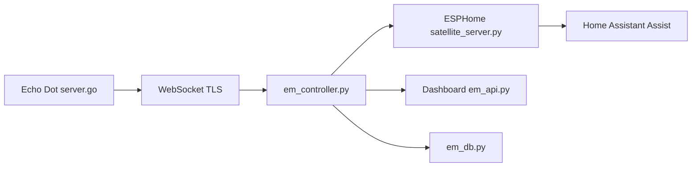

# wilbowes/EchoMuse

> Turns an unlocked 2nd-generation Echo Dot into a local voice satellite for Home Assistant.

## The problem
A second-hand Echo Dot depends on Amazon and Alexa; you want to reuse it as a local voice assistant.

## What it actually does
A Go firmware on the Dot (or emOS, a homemade Linux userspace) streams audio to a Python controller. The controller detects the wake word, manages devices, and exposes the Dot to Home Assistant as an ESPHome satellite and media player (Assist pipeline). Dashboard, WiFi updates, custom wake words (`oww_forge`).

## How it is wired


## Trying it
```bash
mkdir echomuse && cd echomuse
curl -O https://raw.githubusercontent.com/wilbowes/EchoMuse/main/controller/docker-compose.deploy.yml
curl -o .env https://raw.githubusercontent.com/wilbowes/EchoMuse/main/controller/.env.example
docker compose -f docker-compose.deploy.yml up -d
```

## Cost and gotchas
The Dot must be unlocked over USB from Linux (amonet-biscuit), with a risk of bricking it. Home Assistant with Assist is required. The mute button is software-only. Largely written with Claude, by the README's own admission; 145 open issues.

## What it is not
Not Alexa, not standalone, and only the Echo Dot 2 is supported.

## Alternatives
No alternative cited in the README.

## For you
Worth watching: a concrete local-voice case (openWakeWord, Whisper/Piper) for your homelab, if you have a Dot; otherwise of no interest.
