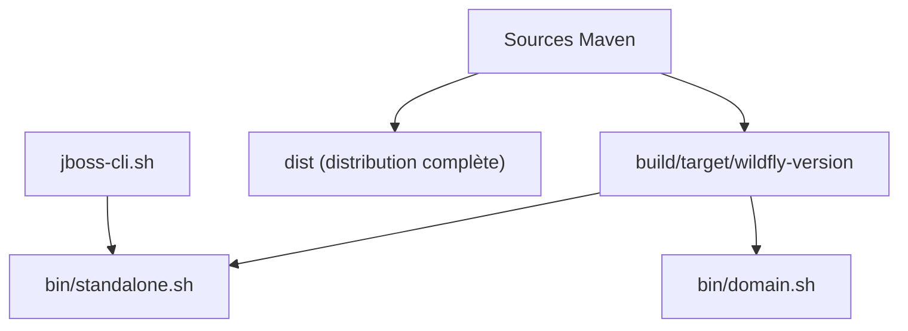

# wildfly/wildfly

> Java application server (Jakarta EE and MicroProfile), with fast startup, configurable in standalone or domain mode.

## The problem
Deploying enterprise Java applications requires a full, modular and administrable server.

## What it actually does
Application server shipped with Jakarta EE and MicroProfile, unified configuration management, and two startup modes: standalone and domain. The build produces two directories, build (modules resolved by Maven, handy for development) and dist (full distribution). A clean shutdown goes through jboss-cli.

## How it is wired
Simplified diagram based on the sheet, no diagram provided.


## Trying it
```bash
mvn install
./mvnw install
cd build/target/wildfly-[version]/bin
./standalone.sh
./domain.sh
./jboss-cli.sh --connect command=:shutdown
mvn test
```

## Cost and gotchas
Free. JDK 17 or later and Maven 3.9 or later required (not in the prerequisites list); the open files limit must be at least 4096 on *nix.

## What it is not
Not a lightweight server for model APIs: it is a full Java EE server. The README only describes building from source, no binary to download.

## Alternatives
No alternative cited in the README.

## For you
Ignore: enterprise Java application server, unrelated to a Python data / AI workflow.
