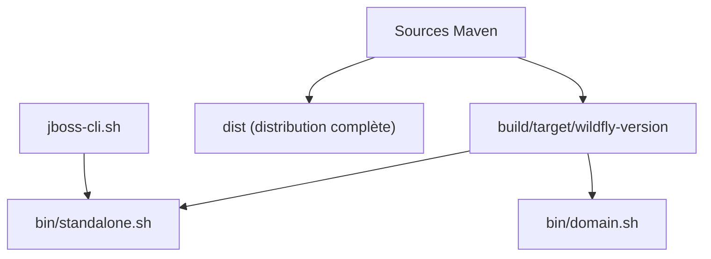

# wildfly/wildfly

> Serveur d'applications Java (Jakarta EE et MicroProfile), à démarrage rapide, configurable en mode standalone ou domaine.

## Le problème
Déployer des applications Java d'entreprise demande un serveur complet, modulaire et administrable.

## Ce que ça fait vraiment
Serveur d'applications livré avec Jakarta EE et MicroProfile, une gestion unifiée de la configuration, et deux modes de démarrage : standalone et domain. Le build produit deux répertoires, build (modules résolus par Maven, pratique pour développer) et dist (distribution complète). Un arrêt propre passe par jboss-cli.

## Comment c'est branché
Schéma simplifié d'après la fiche, sans diagramme fourni.


## Essayer
```bash
mvn install
./mvnw install
cd build/target/wildfly-[version]/bin
./standalone.sh
./domain.sh
./jboss-cli.sh --connect command=:shutdown
mvn test
```

## Coût et pièges
Gratuit. JDK 17 ou plus et Maven 3.9 ou plus requis (hors liste de prérequis) ; la limite de fichiers ouverts doit être d'au moins 4096 sous *nix.

## Ce que ce n'est pas
Pas un serveur léger pour API de modèle : c'est un serveur Java EE complet. Le README ne décrit que la compilation, pas de binaire à télécharger.

## Alternatives
Aucune alternative citée dans le README.

## Pour toi
Ignorer : serveur d'applications Java d'entreprise, sans lien avec un flux data / IA en Python.

