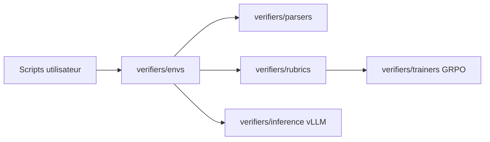

# willccbb/verifiers

> Library for building LLM training and evaluation environments, tied to an environments hub.

## The problem
Training or evaluating an LLM with reinforcement learning requires reproducible environments with verifiable rewards.

## What it actually does
Minimal README (under 800 characters): it announces an environments library, integrated with the Environments Hub, prime-rl and a hosted training platform. From the description of the code: Environment, Parser and Rubric abstractions, a GRPOTrainer and a vLLM client. The README gives no further detail.

## How it is wired


## Trying it
```bash
curl -LsSf https://astral.sh/uv/install.sh | sh
uv tool install prime
```

## Cost and gotchas
Not documented in the README. The ecosystem it mentions (Hosted Training) is a hosted platform, with no pricing given.

## What it is not
It is not documented here: the README points to the docs and to AGENTS.md. Do not infer an API from this text.

## Alternatives
- prime-rl: the training framework cited by the README, with which verifiers integrates.

## For you
Worth watching: relevant topic for RL on LLMs, but insufficient material and an undeclared license to judge further.
