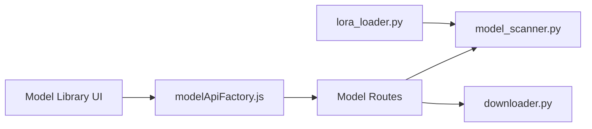

# willmiao/ComfyUI-Lora-Manager

> ComfyUI extension to organize, download and apply LoRAs, checkpoints and generation recipes.

## The problem
LoRA collections keep growing, their keywords and strengths get lost, and finding them in a workflow is tedious.

## What it actually does
Web interface (`/loras`) that scans model folders, fetches metadata and previews from CivitAI, manages checkpoints and embeddings (other types optional), and saves "recipes" of LoRA combinations. ComfyUI nodes (Lora Loader, Text/Prompt with wildcards, Save Image with filename patterns) apply the settings. Standalone mode without ComfyUI.

## How it is wired


## Trying it
```bash
git clone https://github.com/willmiao/ComfyUI-Lora-Manager.git
cd ComfyUI-Lora-Manager
pip install -r requirements.txt
python standalone.py
```

## Cost and gotchas
CivitAI API key needed to download. Standalone mode is configured via `settings.json`. 119 open issues.

## What it is not
Not an image generator: it manages models for ComfyUI. It depends on CivitAI for metadata and downloads. GPL-3.0 license (copyleft).

## Alternatives
No alternative named in the README.

## For you
Worth watching: only useful if you use ComfyUI with many LoRAs; outside image generation, no interest for a data/MLOps profile.
