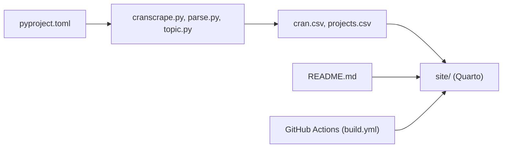

# wilsonfreitas/awesome-quant

> Curated list of libraries, data and resources for quantitative finance, by language and theme.

## The problem
Quantitative finance tools are scattered across languages, data providers and abandoned projects, with no single entry point.

## What it actually does
The README sorts hundreds of entries into sections: numerical libraries, pricing, technical indicators, trading and backtesting, portfolio and risk, time series, market data, prediction markets, calendars, visualization, research environments. One section groups commercial services, another groups historical projects. The descriptions come from the entries' authors and are not verified.

## How it is wired

## Trying it
No documented command: the README is the list itself, to be browsed by section.

## Cost and gotchas
Free, but several entries lead to paid services or rate-limited APIs. No license declared. The catalog is vast, with old entries or ones not updated since 2015.

## What it is not
It is not an evaluated selection: entries are not tested and announced performance cannot be verified here. No executable code to install.

## Alternatives
- awesome-sec-filings: a list dedicated to SEC repositories (13F, 10-K), cited in the README.

## For you
Adopt as an address book: free and broad on time series, backtesting and market data, provided you test each tool before use.
