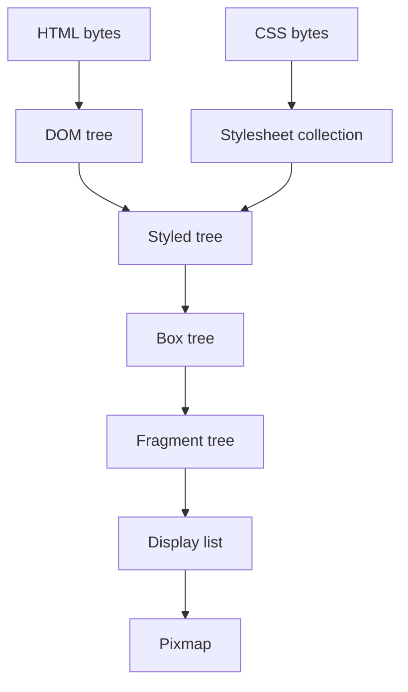

# wilsonzlin/fastrender

> Browser rendering engine in Rust: HTML, CSS, layout, painting and JavaScript, arising from research on parallel code agents.

## The problem
Writing a complete web rendering engine is an immense undertaking; this repository explores whether it can be produced by collaborating AI agents.

## What it actually does
Parses HTML and CSS, computes styles by cascade, builds a box tree, performs layout (block, inline, flex, grid via Taffy, tables), paints a display list, then rasterizes to a pixmap. Includes a JavaScript engine (vm-js) with an event loop, a desktop browser and system sandboxes.

## How it is wired
Simplified diagram based on the sheet, no diagram provided.


## Trying it
```bash
git submodule update --init vendor/ecma-rs
cargo run --release --features browser_ui --bin browser
cargo test --lib
```

## Cost and gotchas
Free, but with no declared license: reuse is uncertain. The README announces intense development, unstable APIs and advises against production use. Requires Rust 1.70+, CMake and system libraries.

## What it is not
Not a browser usable day to day: JavaScript coverage is partial and the multi-process architecture remains a target.

## Alternatives
No alternative named in the README.

## For you
Worth watching: a case study of code produced by AI agents, instructive but unlicensed and unstable.
