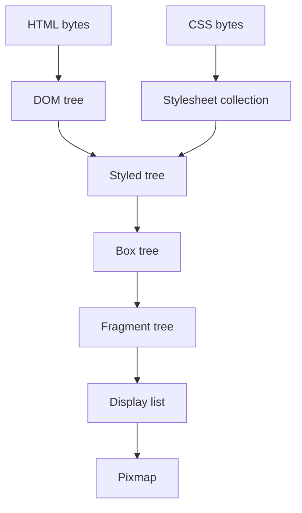

# wilsonzlin/fastrender

> Moteur de rendu de navigateur en Rust : HTML, CSS, mise en page, peinture et JavaScript, issu d'une recherche sur des agents de code parallèles.

## Le problème
Écrire un moteur de rendu web complet est un chantier immense ; ce dépôt explore s'il peut être produit par des agents IA qui collaborent.

## Ce que ça fait vraiment
Analyse le HTML et le CSS, calcule les styles par cascade, construit un arbre de boîtes, fait la mise en page (bloc, ligne, flex, grille via Taffy, tableaux), peint un display list, puis rastérise en pixmap. Intègre un moteur JavaScript (vm-js) avec boucle d'événements, un navigateur de bureau et des sandbox système.

## Comment c'est branché
Schéma simplifié d'après la fiche, sans diagramme fourni.


## Essayer
```bash
git submodule update --init vendor/ecma-rs
cargo run --release --features browser_ui --bin browser
cargo test --lib
```

## Coût et pièges
Gratuit, mais sans licence déclarée : réutilisation incertaine. Le README annonce un développement intense, des API instables et le déconseille en production. Exige Rust 1.70+, CMake et des bibliothèques système.

## Ce que ce n'est pas
Pas un navigateur utilisable au quotidien : la couverture JavaScript est partielle et l'architecture multi-processus reste une cible.

## Alternatives
Aucune alternative nommée dans le README.

## Pour toi
À surveiller : cas d'étude de code produit par des agents IA, instructif mais sans licence et instable.

