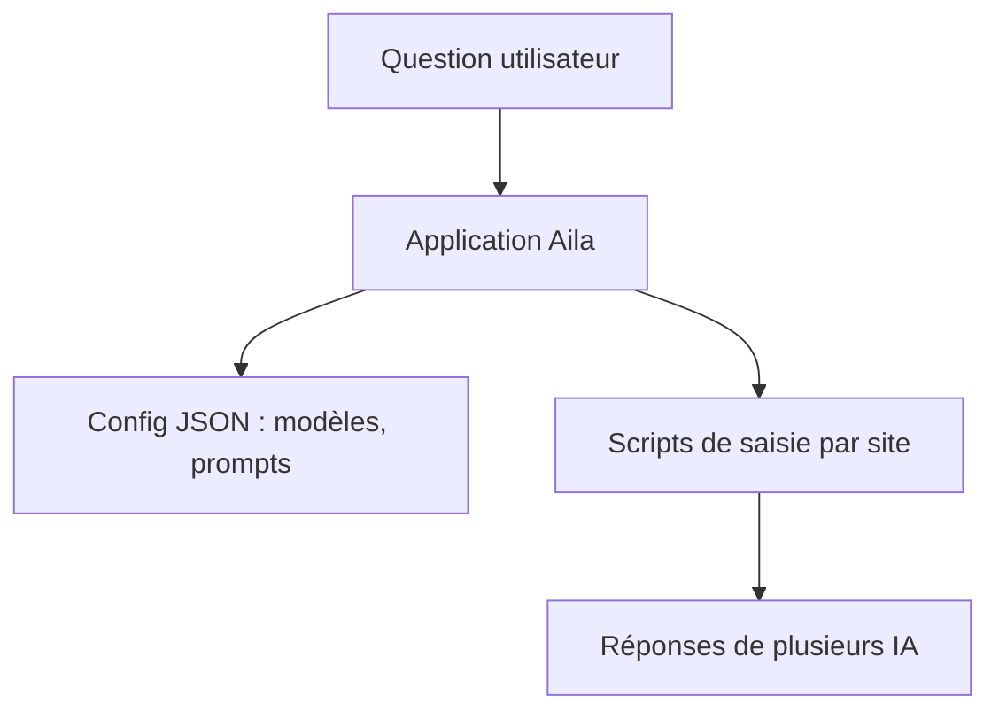

# win4r/AISuperDomain

> Aila desktop app that sends a question to several chatbots at once, for Windows and macOS users.

## The problem
Comparing the answers of several assistants means opening one tab per service and retyping the question.

## What it actually does
Aila displays 1, 2, 3, 4 or 6 AIs side by side, with simultaneous answers and a full-screen mode per AI. A JSON configuration file lets you add models and prompts; for a new service, the author advises having ChatGPT write a script from the HTML of the input field.

## How it is wired
Simplified diagram based on the sheet, no diagram provided.

## Trying it
No command: download the latest version from Aila Releases. Windows requires .NET 8 and installing a provided certificate; macOS: double-click.

## Cost and gotchas
Free, but Windows requires .NET 8 and a certificate to install. The input scripts depend on the services' web pages and may break when they change (not documented).

## What it is not
Not a usable code repository: the README describes binaries published elsewhere. No architecture or tests documented.

## Alternatives
No alternative named in the README.

## For you
Ignore: binary to install with a certificate, undocumented code, and a chatbot aggregator that brings nothing to data or MLOps work.
