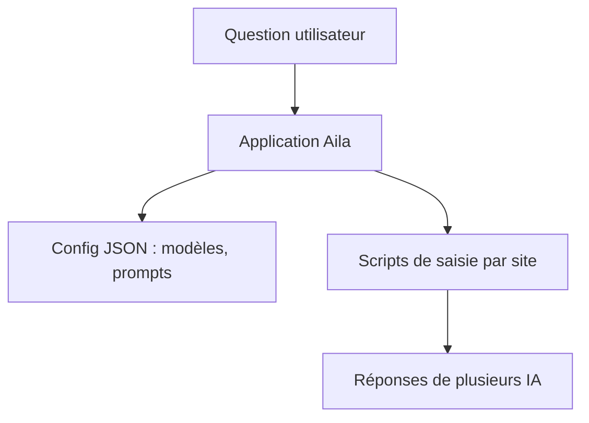

# win4r/AISuperDomain

> Appli de bureau Aila qui envoie une question à plusieurs chatbots à la fois, pour utilisateurs Windows et macOS.

## Le problème
Comparer les réponses de plusieurs assistants oblige à ouvrir un onglet par service et à retaper la question.

## Ce que ça fait vraiment
Aila affiche 1, 2, 3, 4 ou 6 IA côte à côte, avec réponses simultanées et mode plein écran par IA. Un fichier JSON de configuration permet d'ajouter des modèles et des prompts ; pour un nouveau service, l'auteur conseille de faire écrire un script par ChatGPT à partir du HTML du champ de saisie.

## Comment c'est branché
Schéma simplifié d'après la fiche, sans diagramme fourni.

## Essayer
Aucune commande : télécharger la dernière version dans Aila Releases. Windows exige .NET 8 et l'installation d'un certificat fourni ; macOS : double-clic.

## Coût et pièges
Gratuit, mais Windows demande .NET 8 et un certificat à installer. Les scripts de saisie dépendent des pages web des services et peuvent casser quand elles changent (non documenté).

## Ce que ce n'est pas
Pas un dépôt de code exploitable : le README décrit des binaires publiés ailleurs. Aucune architecture ni test documenté.

## Alternatives
Aucune alternative nommée dans le README.

## Pour toi
À ignorer : binaire à installer avec certificat, code non documenté, et un agrégateur de chatbots qui n'apporte rien à un travail data ou MLOps.

