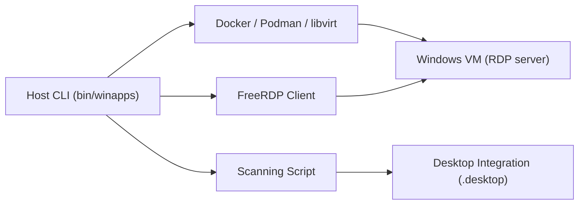

# winapps-org/winapps

> Runs Windows applications in a virtual machine and integrates them into the Linux desktop via FreeRDP.

## The problem
Some applications (Microsoft 365, Adobe) do not exist on Linux, and dual booting is a pain.

## What it actually does
Runs Windows in Docker, Podman or libvirt (KVM), detects installed applications, creates `.desktop` shortcuts and displays each application as a native window via FreeRDP. The Linux home folder is mounted. Optional system tray launcher and Nix packages.

## How it is wired


## Trying it
```bash
sudo apt install -y curl dialog freerdp3-x11 git iproute2 libnotify-bin netcat-openbsd
bash <(curl https://raw.githubusercontent.com/winapps-org/winapps/main/setup.sh)
winapps-setup --user --add-apps
```

## Cost and gotchas
Free, but you need a Windows license and suitable hardware (KVM). The Windows password is stored in `winapps.conf`: chmod 600 is indicated. FreeRDP 3 minimum.

## What it is not
Not an emulator: it is a full Windows in a virtual machine. A license is present but not identified by GitHub.

## Alternatives
No alternative named in the README.

## For you
Ignore: only useful if you work on Linux and depend on a specific Windows application.
