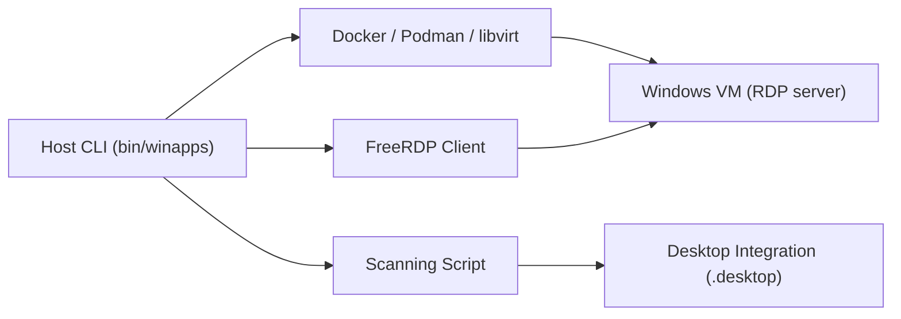

# winapps-org/winapps

> Exécute des applications Windows dans une machine virtuelle et les intègre au bureau Linux via FreeRDP.

## Le problème
Certaines applications (Microsoft 365, Adobe) n'existent pas sous Linux, et un double démarrage est pénible.

## Ce que ça fait vraiment
Lance Windows dans Docker, Podman ou libvirt (KVM), détecte les applications installées, crée des raccourcis `.desktop` et affiche chaque application comme une fenêtre native via FreeRDP. Le dossier personnel Linux est monté. Lanceur de barre système et paquets Nix optionnels.

## Comment c'est branché


## Essayer
```bash
sudo apt install -y curl dialog freerdp3-x11 git iproute2 libnotify-bin netcat-openbsd
bash <(curl https://raw.githubusercontent.com/winapps-org/winapps/main/setup.sh)
winapps-setup --user --add-apps
```

## Coût et pièges
Gratuit, mais il faut une licence Windows et du matériel (KVM). Le mot de passe Windows est dans `winapps.conf` : le chmod 600 est indiqué. FreeRDP 3 minimum.

## Ce que ce n'est pas
Pas un émulateur : c'est un Windows complet en machine virtuelle. Licence présente mais non identifiée par GitHub.

## Alternatives
Aucune alternative nommée dans le README.

## Pour toi
À ignorer : ne sert que si tu travailles sous Linux et dépends d'une application Windows précise.

