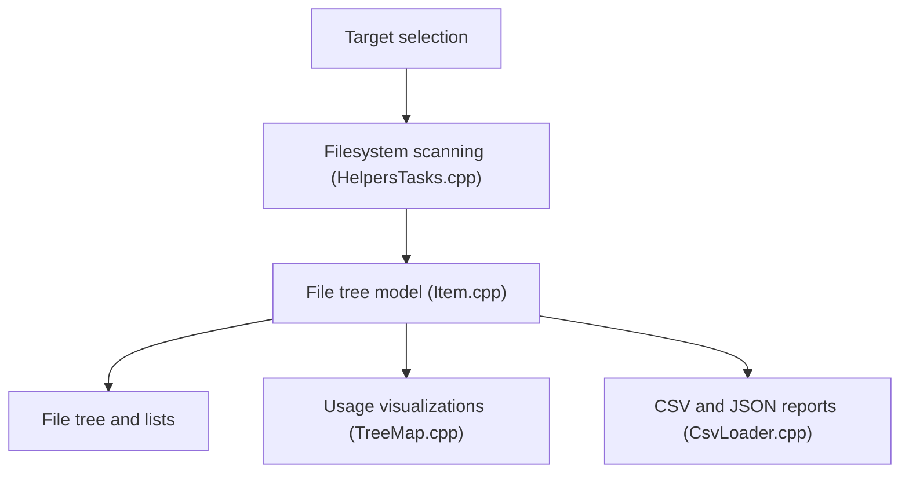

# windirstat/windirstat

> Disk space analyzer for Windows, with treemap, duplicates and cleanup, for local disks and cloud storage.

## The problem
A full disk with no idea which folders or files take up the space.

## What it actually does
Scans disks, folders, network shares, MTP devices, S3, Azure Blob or WebDAV, then displays a sortable list, statistics by type and visualizations (treemap, sunburst, flame graph). Detects duplicates by hashing, inspects permissions, estimates storage costs, exports to CSV or JSON, recovers deleted files (NTFS, exFAT, FAT).

## How it is wired
Diagram based on the provided diagram.



## Trying it
```bash
winget install -e --id WinDirStat.WinDirStat
choco install windirstat
scoop install extras/windirstat
```

## Cost and gotchas
Free. The accelerated NTFS scan and file recovery require administrator rights. Beware of fake sites: install only via the Store, package managers or official releases.

## What it is not
Not a cross-platform tool: Windows only. The cloud scan lists metadata without detecting duplicates.

## Alternatives
No alternative named in the README.

## For you
Ignore for your data / AI / MLOps work: a Windows disk cleanup utility, worthwhile only if you are on Windows.
