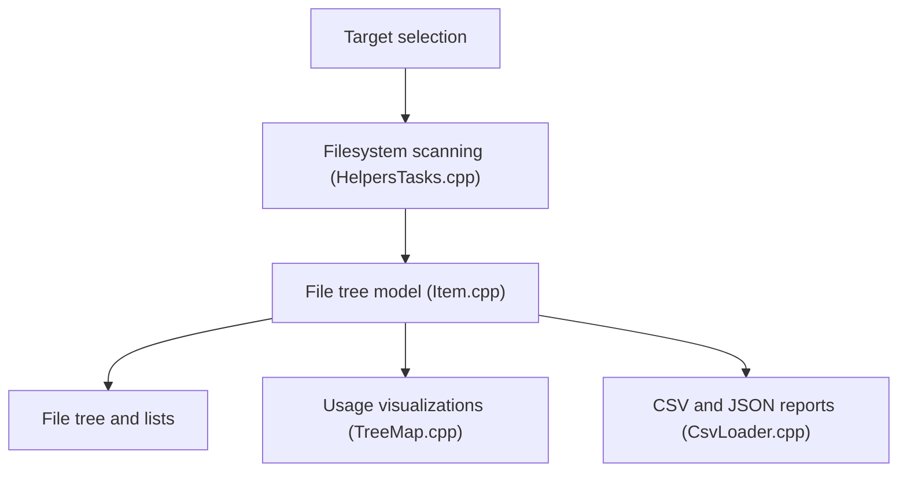

# windirstat/windirstat

> Analyseur d'espace disque pour Windows, avec treemap, doublons et nettoyage, pour disques locaux et stockage cloud.

## Le problème
Un disque plein sans savoir quels dossiers ou fichiers occupent la place.

## Ce que ça fait vraiment
Scanne des disques, dossiers, partages réseau, appareils MTP, S3, Azure Blob ou WebDAV, puis affiche liste triable, statistiques par type et visualisations (treemap, sunburst, flame graph). Détecte les doublons par hachage, inspecte les permissions, estime les coûts de stockage, exporte en CSV ou JSON, récupère des fichiers supprimés (NTFS, exFAT, FAT).

## Comment c'est branché
Schéma d'après le diagramme fourni.



## Essayer
```bash
winget install -e --id WinDirStat.WinDirStat
choco install windirstat
scoop install extras/windirstat
```

## Coût et pièges
Gratuit. Le scan NTFS accéléré et la récupération de fichiers demandent les droits administrateur. Méfie-toi des faux sites : installer seulement via Store, gestionnaires de paquets ou releases officielles.

## Ce que ce n'est pas
Pas un outil multiplateforme : Windows uniquement. Le scan cloud liste les métadonnées sans détecter de doublons.

## Alternatives
Aucune alternative nommée dans le README.

## Pour toi
À ignorer pour ton travail data / IA / MLOps : utilitaire Windows de nettoyage disque, valable seulement si tu es sous Windows.

