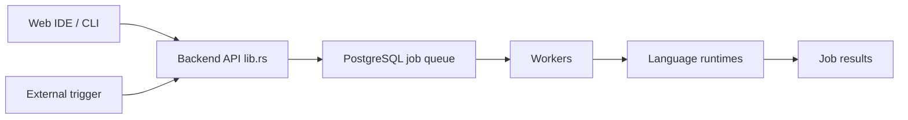

# windmill-labs/windmill

> Self-hostable platform that turns scripts into APIs, workflows and UIs, an alternative to Retool, Pipedream and a simplified Temporal.

## The problem
Internal scripts (Python, SQL, Bash) remain isolated files: no interface, scheduling, traceability or sharing.

## What it actually does
Each script gets an interface generated from its parameters, can be chained into flows, triggered by schedule, webhook, HTTP route, Kafka, WebSocket, e-mail, then exposed in low-code apps. Rust backend (stateless API + workers pulling from a Postgres queue), Svelte 5 front end, nsjail isolation, secrets encrypted per workspace. Languages: Python, TypeScript, Go, Bash, SQL, Rust, etc.

## How it is wired


## Trying it
```bash
curl https://raw.githubusercontent.com/windmill-labs/windmill/main/docker-compose.yml -o docker-compose.yml
curl https://raw.githubusercontent.com/windmill-labs/windmill/main/Caddyfile -o Caddyfile
curl https://raw.githubusercontent.com/windmill-labs/windmill/main/.env -o .env
docker compose up -d
```
Default login: `admin@windmill.dev` / `changeme`.

## Cost and gotchas
Free when self-hosted (AGPLv3 according to the README; the catalogue flags the license as unidentified). Paid Enterprise edition (metrics, GCP Pub/Sub). Change the default credentials; plan 1 worker per vCPU.

## What it is not
Not a data orchestrator in the Airflow sense: built for internal code. The benchmarks are the vendor's own.

## Alternatives
Airflow, Prefect, Temporal (compared in the benchmarks); Retool, Pipedream, Superblocks (cited as replaced).

## For you
Very useful for industrializing Python/SQL scripts into flows and internal interfaces with Postgres; adopt as a pilot.
