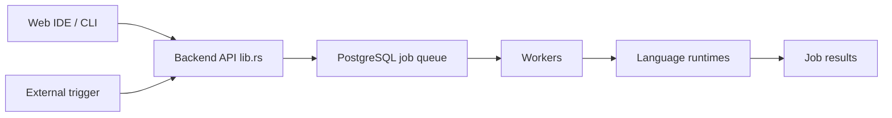

# windmill-labs/windmill

> Plateforme auto-hébergeable qui transforme scripts en API, flux et interfaces, alternative à Retool, Pipedream et Temporal simplifié.

## Le problème
Les scripts internes (Python, SQL, Bash) restent des fichiers isolés : pas d'interface, de planification, de traçabilité ni de partage.

## Ce que ça fait vraiment
Chaque script reçoit une interface générée depuis ses paramètres, peut être chaîné en flux, déclenché par planning, webhook, route HTTP, Kafka, WebSocket, e-mail, puis exposé dans des applications low-code. Backend Rust (API sans état + workers qui tirent une file Postgres), front Svelte 5, isolation nsjail, secrets chiffrés par espace de travail. Langages : Python, TypeScript, Go, Bash, SQL, Rust, etc.

## Comment c'est branché


## Essayer
```bash
curl https://raw.githubusercontent.com/windmill-labs/windmill/main/docker-compose.yml -o docker-compose.yml
curl https://raw.githubusercontent.com/windmill-labs/windmill/main/Caddyfile -o Caddyfile
curl https://raw.githubusercontent.com/windmill-labs/windmill/main/.env -o .env
docker compose up -d
```
Connexion par défaut : `admin@windmill.dev` / `changeme`.

## Coût et pièges
Gratuit auto-hébergé (AGPLv3 selon le README ; le catalogue signale la licence comme non identifiée). Édition Enterprise payante (métriques, GCP Pub/Sub). Changer les identifiants par défaut ; compter 1 worker par vCPU.

## Ce que ce n'est pas
Pas un orchestrateur de données au sens d'Airflow : pensé pour le code interne. Les benchmarks sont ceux de l'éditeur.

## Alternatives
Airflow, Prefect, Temporal (comparés dans les benchmarks) ; Retool, Pipedream, Superblocks (cités comme remplacés).

## Pour toi
Très utile pour industrialiser des scripts Python/SQL en flux et interfaces internes avec Postgres ; à adopter en pilote.

