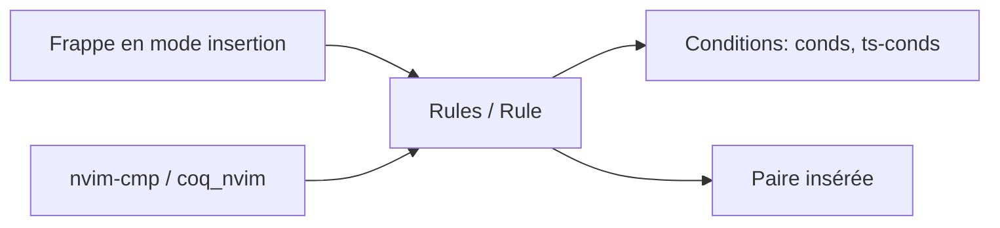

# windwp/nvim-autopairs

> A Neovim plugin that automatically closes parentheses, quotes and multi-character pairs.

## The problem
Typing closing symbols by hand and handling nested pairs.

## What it actually does
Inserts the pair, jumps over the closing character, deletes the pair on backspace, handles `<CR>` between braces. Customizable rules (`Rule`, conditions, regex), Tree-sitter checks, "FastWrap" (`<M-e>`), nvim-cmp and coq_nvim integration. Neovim 0.7+.

## How it is wired


## Trying it
```lua
{ 'windwp/nvim-autopairs', event = "InsertEnter", config = true }
require("nvim-autopairs").setup { disable_filetype = { "TelescopePrompt", "vim" } }
```

## Cost and gotchas
Free. With another completion plugin, you must remap `<CR>` and `<BS>` by hand. The README ends with nearly empty sections (autotag, endwise, rules: links only).

## What it is not
Not a completion or snippet engine.

## Alternatives
No alternative named.

## For you
Ignore: a minor editing convenience; add it only if you already use Neovim.
