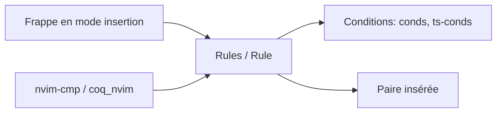

# windwp/nvim-autopairs

> Plugin Neovim qui ferme automatiquement parenthèses, guillemets et paires multi-caractères.

## Le problème
Taper à la main les symboles fermants et gérer les paires imbriquées.

## Ce que ça fait vraiment
Insère la paire, saute le caractère fermant, supprime la paire à l'effacement, gère `<CR>` entre accolades. Règles personnalisables (`Rule`, conditions, regex), vérification Tree-sitter, « FastWrap » (`<M-e>`), intégration nvim-cmp et coq_nvim. Neovim 0.7+.

## Comment c'est branché


## Essayer
```lua
{ 'windwp/nvim-autopairs', event = "InsertEnter", config = true }
require("nvim-autopairs").setup { disable_filetype = { "TelescopePrompt", "vim" } }
```

## Coût et pièges
Gratuit. Avec une autre complétion, il faut remapper `<CR>` et `<BS>` à la main. Le README se termine par des sections presque vides (autotag, endwise, rules : liens seuls).

## Ce que ce n'est pas
Pas un moteur de complétion ni de snippets.

## Alternatives
Aucune alternative nommée.

## Pour toi
Ignorer : micro-confort d'édition ; l'ajouter seulement si tu utilises déjà Neovim.

