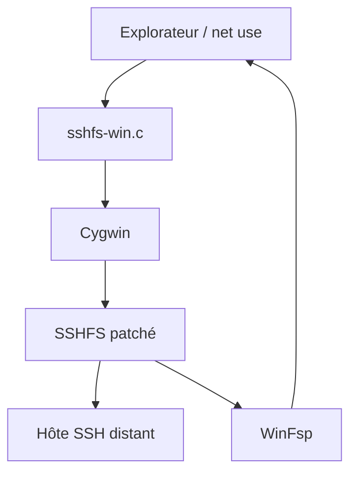

# winfsp/sshfs-win

> Port of SSHFS for Windows: mount a remote folder over SSH as a network drive.

## The problem
Accessing files on a Linux server from Windows means copying with scp or installing a dedicated client.

## What it actually does
A `sshfs-win.c` wrapper around the original SSHFS (a patched submodule), run under Cygwin, with WinFsp handling the FUSE side. You map a drive with Explorer or `net use` using a UNC syntax `\\sshfs\USER@HOST`. Four prefixes handle the home folder or the root, with a password or a key without a passphrase. Four third-party graphical interfaces exist.

## How it is wired


## Trying it
```bash
winget install SSHFS-Win.SSHFS-Win
net use X: \\sshfs\billziss@mac2018.local
net use X: /delete
```

## Cost and gotchas
Free. WinFsp must be installed separately. Only keys without a passphrase are supported. Idle connections drop after a few minutes without `ServerAliveInterval`. No built-in SSH jump host.

## What it is not
Not an interactive SFTP client. It does not manage SSH tunnels itself. Windows only. The license is not identified by GitHub.

## Alternatives
SiriKali, SSHFS-Win-Manager, NEO SSH-Win Manager and sshfs-win-tray as graphical interfaces.

## For you
Worth watching: useful if you work on Windows and want to see a Linux GPU server as a local drive.
