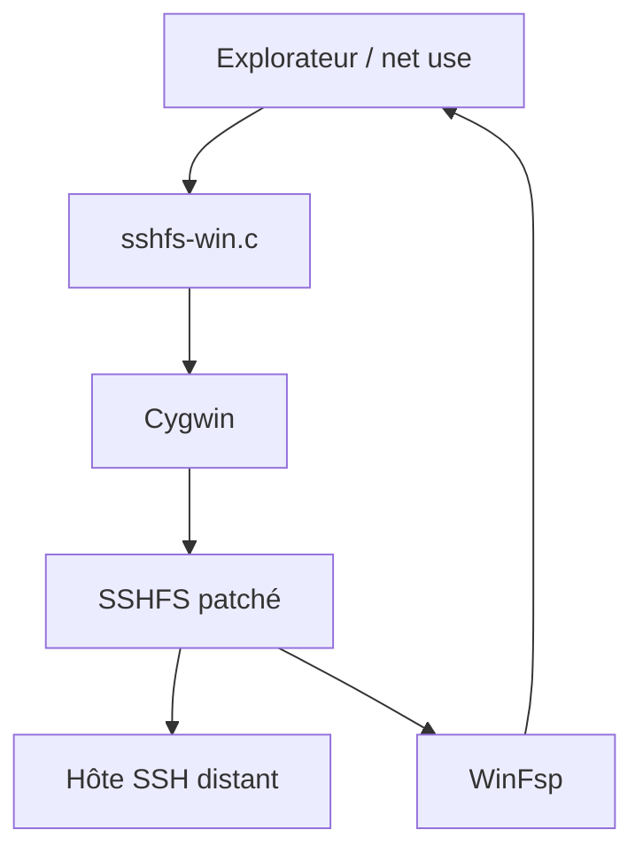

# winfsp/sshfs-win

> Port de SSHFS pour Windows : monter un dossier distant en SSH comme lecteur réseau.

## Le problème
Accéder aux fichiers d'un serveur Linux depuis Windows oblige à copier avec scp ou à installer un client dédié.

## Ce que ça fait vraiment
Enveloppe `sshfs-win.c` autour du SSHFS d'origine (sous-module patché), exécuté sous Cygwin, avec WinFsp pour la partie FUSE. On mappe un lecteur avec l'Explorateur ou `net use` via une syntaxe UNC `\\sshfs\USER@HOST`. Quatre préfixes gèrent le dossier personnel ou la racine, avec mot de passe ou clé sans phrase secrète. Quatre interfaces graphiques tierces existent.

## Comment c'est branché


## Essayer
```bash
winget install SSHFS-Win.SSHFS-Win
net use X: \\sshfs\billziss@mac2018.local
net use X: /delete
```

## Coût et pièges
Gratuit. WinFsp doit être installé en plus. Seules les clés sans phrase secrète sont prises en charge. Les connexions inactives coupent après quelques minutes sans `ServerAliveInterval`. Pas de rebond SSH intégré.

## Ce que ce n'est pas
Ce n'est pas un client SFTP interactif. Il ne gère pas les tunnels SSH lui-même. Windows uniquement. La licence n'est pas identifiée par GitHub.

## Alternatives
SiriKali, SSHFS-Win-Manager, NEO SSH-Win Manager et sshfs-win-tray comme interfaces graphiques.

## Pour toi
À surveiller : utile si tu travailles sous Windows et veux voir un serveur GPU Linux comme un lecteur local.

