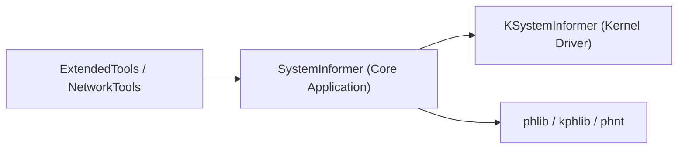

# winsiderss/systeminformer

> Resource monitor and process debugger for Windows, portable.

## The problem
Finding out which process is locking a file, consuming CPU, disk or network, or behaving like malware.

## What it actually does
Detailed process view with graphs, locked files, network connections, disk access, stack traces (kernel, WOW64, .NET), advanced service management. A kernel driver (KSystemInformer) and plugins (ExtendedTools, NetworkTools…) extend the application core.

## How it is wired


## Trying it
```bash
build\build_init.cmd
build\build_release.cmd
```

## Cost and gotchas
Free, MIT. Build with Visual Studio 2022+. Windows 10 or later only. The kernel driver requires elevated privileges.

## What it is not
Not a Linux tool nor an EDR. No documented telemetry.

## Alternatives
No alternative named in the README.

## For you
Ignore: a Windows system diagnostic tool, useful occasionally but unrelated to data/AI.
