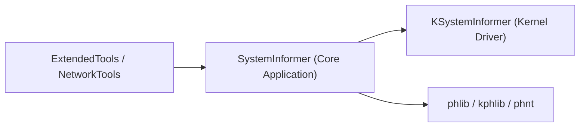

# winsiderss/systeminformer

> Moniteur de ressources et débogueur de processus pour Windows, portable.

## Le problème
Savoir quel processus bloque un fichier, consomme CPU, disque ou réseau, ou se comporte comme un malware.

## Ce que ça fait vraiment
Vue détaillée des processus avec graphes, fichiers verrouillés, connexions réseau, accès disque, traces de pile (noyau, WOW64, .NET), gestion avancée des services. Un pilote noyau (KSystemInformer) et des plugins (ExtendedTools, NetworkTools…) étendent le noyau applicatif.

## Comment c'est branché


## Essayer
```bash
build\build_init.cmd
build\build_release.cmd
```

## Coût et pièges
Gratuit, MIT. Compilation avec Visual Studio 2022+. Windows 10 ou plus uniquement. Le pilote noyau requiert des droits élevés.

## Ce que ce n'est pas
Pas un outil Linux ni un EDR. Pas de télémétrie documentée.

## Alternatives
Aucune alternative nommée dans le README.

## Pour toi
À ignorer : outil Windows de diagnostic système, utile ponctuellement mais sans lien avec data/IA.

