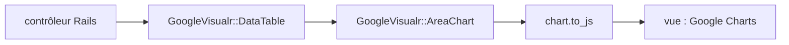

# winston/google_visualr

> Ruby gem that generates Google Charts graphs without writing JavaScript, for Rails or Sinatra applications.

## The problem
Integrating Google Charts into a Ruby application requires writing JavaScript in the views.

## What it actually does
Provides Ruby classes (`DataTable`, `AreaChart`...) whose options mirror Google's. The call `chart.to_js(div_id)` produces the JavaScript injected into the view. Version, language and Material mode can be set. Google's methods and events are not covered.

## How it is wired
Simplified diagram based on the sheet, no diagram provided.



## Trying it
```ruby
gem "google_visualr", ">= 2.5"
```
```ruby
data_table = GoogleVisualr::DataTable.new
@chart = GoogleVisualr::Interactive::AreaChart.new(data_table, { width: 400, height: 240, title: 'Company Performance' })
```

## Cost and gotchas
Requires Ruby and Rails 3/4 according to the README, as well as loading Google Charts in the browser. Last push in 2021: probably unmaintained for recent Rails versions.

## What it is not
Not a data visualization tool for Python nor a complete wrapper of Google Charts. The charts depend on a Google service loaded at runtime.

## Alternatives
No alternative named in the README.

## For you
Ignore: an old Ruby and Rails ecosystem, unrelated to a Python data or AI stack.
